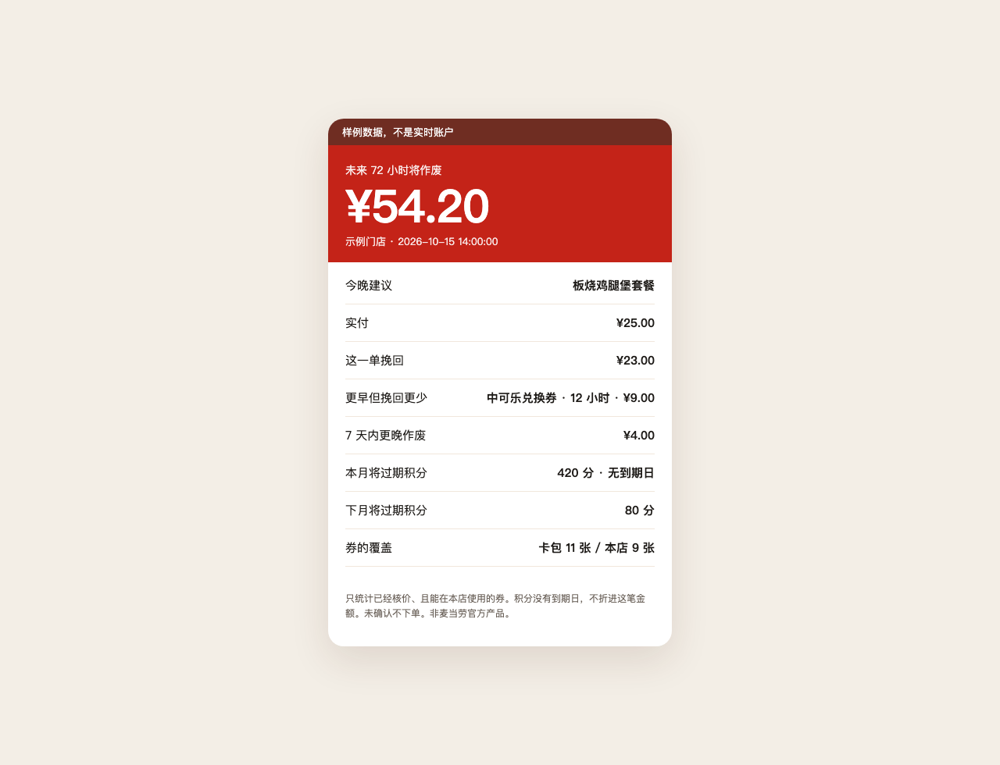

# 麦麦权益止损官

未来 72 小时，已经核过价、并且这家店能用的优惠，一共会作废多少。今晚哪一单挽回最多。

```text
样例数据，不是实时账户。
麦麦权益止损官
未来 72 小时将作废    ¥54.20
今晚建议              板烧鸡腿堡套餐
实付                  ¥25.00
这一单挽回            ¥23.00
更早到期但挽回更少    中可乐兑换券，约 12 小时后作废，挽回 ¥9.00
7 天内更晚作废        ¥4.00
本月将过期积分        420（接口没有到期日，不计入上面的金额）
卡包 11 张，本店返回 9 张
未确认不下单。价格来自 calculate-price。
```

样例页面：[`docs/card-demo.html`](docs/card-demo.html)



省钱类 Skill 回答「这一单怎么最便宜」。这个 Skill 回答另一件事：快过期的优惠里，哪一单能把已核价的优惠挽回最多。更早到期、但挽回更少的券会单独标出来，不跟金额最大的那张混在一起。

## 目标用户

- 卡包里有券，但不知道这家店今晚实际能用哪几张的人
- 被「即将到期」推着下单，又想先看到实付和挽回金额的人
- 想知道本月有多少积分将过期，同时不想把积分折成一个没依据的现金数的人

## 它做什么

1. 用 `query-store-coupons` 取本店、本渠道真正能用的券（含券编号和有效期）。
2. 用 `query-my-coupons` 只做张数对照。卡包里的券不一定带券编号，也不一定这家店能用。
3. 每张候选券单独调用 `calculate-price`。金额只认返回里的「分」。
4. 把 72 小时内、已经核价的优惠加总，选出挽回金额最大的一单。
5. 积分用 `query-my-account` 的本月 / 下月将过期数量展示。接口没有到期日时，不折进头条金额。

默认不领券、不兑换、不下单。用户明确确认之后，才可以调用 `create-order`。

## 安装

前置：在 [open.mcd.cn/mcp](https://open.mcd.cn/mcp) 用手机号登录并激活 Token。Token 只放在本机，不要提交进仓库。

```bash
git clone https://github.com/yuanZ1/yuanZ1.git
cd mcd-benefit-stop
bash scripts/install_skill.sh
```

Skill 会装到 `~/.workbuddy/skills/mcd-benefit-stop`。WorkBuddy 的 MCP 配置见 [`mcp-config.example.json`](mcp-config.example.json)，把 `${MCD_MCP_TOKEN}` 换成你自己的 Token 后再保存到本机配置，不要把替换后的文件提交。

装好后重开一轮对话，直接说：

> 我账户里 72 小时内会作废多少麦当劳优惠？这家店今晚哪一单挽回最多？不要下单。

## 不连 MCP 也能看结果

```bash
python3 skills/mcd-benefit-stop/scripts/demo.py
python3 skills/mcd-benefit-stop/scripts/selftest.py
```

`selftest.py` 当前是 29 项断言。样例数据是手工构造的，字段名对齐公开接口里已经出现过的键，不是某一次真实账户的快照。

有 Token 之后，可以只读探测字段，结果写到被 git 忽略的 `fixtures/live/`：

```bash
export MCD_MCP_TOKEN="你的 Token"
python3 skills/mcd-benefit-stop/scripts/probe_mcp.py
```

这条命令不会领券、下单或兑换。

## 三条用法

1. `未来 72 小时我有多少麦当劳优惠会作废？今晚哪一单挽回最多？不要下单。`
2. `到店吃，不要甜品。只看这家店真正能用的券。`
3. `本月将过期的积分有多少？没有到期日就不要折成现金。`

## 边界

- 同一单只用一张券。接口没有给出叠加规则时，不假设几张券能叠在一起。
- 核价结果自相矛盾，或券没有编号，这张券不进入金额，也不进入推荐。
- 没有有效期的券只计数，不编一个剩余天数。
- 已经过期的券不参与推荐。
- 价格是查询那一刻的核价结果。餐品、价格和供应以麦当劳官方渠道的实时结果为准。

本项目是麦当劳程序员创意开发大赛参赛作品，由参赛者独立开发，非麦当劳官方产品。
